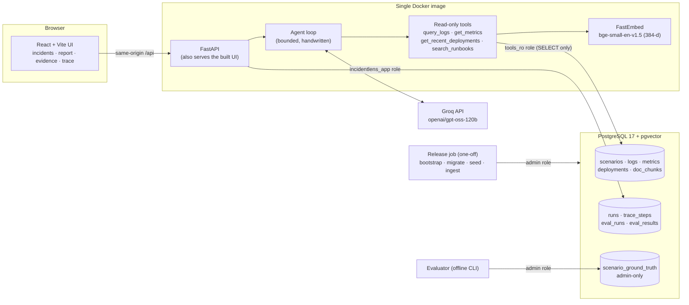

# IncidentLens

**An AI incident-triage copilot that investigates an incident's evidence with read-only tools and
returns a root-cause hypothesis in which every claim cites the evidence behind it.**

IncidentLens takes the evidence an on-call engineer would look at (logs, metrics, deployment
records) plus a library of runbooks, and runs a bounded AI agent over it. The agent can only
*read* evidence belonging to the incident under investigation. Its answer is validated before it is
shown: citations must point at evidence the tools actually returned, unsupported "facts" are
demoted, and recommendations are advisory only. IncidentLens never changes any system.

> **Scope of v1.** IncidentLens analyses evidence that is *supplied to it*: four simulated demo
> incidents, open to everyone, plus private incidents that signed-in users create by pasting or
> uploading logs, metrics CSV and deployment CSV. It does **not** connect to live monitoring systems (Datadog, Prometheus, etc.);
> that is planned for a later version.

---

## Contents
- [What problem it solves](#what-problem-it-solves)
- [Architecture](#architecture)
- [How an investigation works](#how-an-investigation-works)
- [Evidence, citations and validation](#evidence-citations-and-validation)
- [Safety: hallucinations, prompt injection, data access](#safety-hallucinations-prompt-injection-data-access)
- [Accounts and access control](#accounts-and-access-control)
- [Evaluation](#evaluation)
- [Run it locally](#run-it-locally)
- [Configuration](#configuration)
- [Tests](#tests)
- [Deployment](#deployment)
- [Known limitations](#known-limitations)
- [Roadmap (v2)](#roadmap-v2)
- [Repository layout](#repository-layout)

## What problem it solves

During an incident, engineers must quickly answer: *what changed, which service failed first, and
what does the evidence actually show?* Large language models can help summarise, but they also
invent plausible-sounding causes. IncidentLens explores a narrower, verifiable pattern:

- the model **gathers** evidence through typed, bounded, read-only tools;
- it must separate **observed facts** (each tied to evidence IDs) from its **hypothesis**;
- the server **checks** every citation against what the tools returned in that run;
- everything the agent did is recorded as an inspectable **trace**.

## Architecture



| Layer | Technology |
|---|---|
| Frontend | React 19 + JavaScript (JSX) + Vite, no UI framework |
| Backend | Python 3.13, FastAPI, Pydantic v2, `uv` |
| Database | PostgreSQL 17 + pgvector 0.8.7, accessed with psycopg 3 and parameterized SQL (no ORM) |
| LLM | Groq (`openai/gpt-oss-120b`) through the OpenAI-compatible SDK |
| Embeddings | FastEmbed `BAAI/bge-small-en-v1.5`, 384 dimensions, runs locally in the container |
| Packaging | One Docker image (API + built UI); PostgreSQL runs separately |

### Database roles (least privilege)
| Role | Used by | Can do |
|---|---|---|
| `postgres` (admin) | release job, evaluator, pruning, test reset | everything; never given to the web service |
| `incidentlens_app` | web API | read incidents; insert user incidents/evidence and delete them (never demos, enforced by triggers); write runs and traces; create accounts and sessions |
| `tools_ro` | agent tools | `SELECT` on incident data only (nothing on accounts or sessions); read-only session; 5 s statement timeout |

Ground truth for evaluation lives in a table that **neither** application role can read.

## How an investigation works

1. **Start.** `POST /api/incidents/{slug}/investigations` creates a run (bounded by concurrency and
   hourly limits) and executes it in the background. The UI polls for progress.
2. **Prompt.** The model receives fixed system instructions and the incident's title and alert,
   wrapped in an `UNVERIFIED` block (user text is treated as a claim, never as instructions).
3. **Tool loop.** The model requests tools; each call is validated (typed arguments, unknown fields
   rejected, services allow-listed to the incident's own services, bounded time windows and result
   sizes) and executed on a `tools_ro` connection bound to this incident only.
4. **Budgets.** At most 8 model turns, 10 tool calls, 3,500 characters per tool result and a
   300-second budget; when exhausted the model is forced to answer with what it has.
5. **Report.** The model returns JSON: observed **facts** (each with evidence IDs), a root-cause
   **hypothesis**, confidence, alternative explanations, **recommendations** and **unknowns**.
6. **Validation** (server side, see below), then the run, report and every step are stored.

### The tools
| Tool | What it returns |
|---|---|
| `query_logs` | Log lines grouped by identical message, with counts, first/last seen and stable IDs (`log:0042`) |
| `get_metrics` | Per-series summary: baseline (only from data > 30 min before the start; reported as unavailable otherwise), min/max/latest, first deviation, sampled points (`metric:svc:name`) |
| `get_recent_deployments` | Deployments before and just after the start (`deploy:2`) |
| `search_runbooks` | Semantic search over runbook chunks (`runbook:file.md#1`) |

### RAG
Runbooks (`backend/runbooks/*.md`) are split by heading, embedded locally with FastEmbed and stored
as `vector(384)` in `doc_chunks`. `search_runbooks` embeds the query and ranks chunks by cosine
distance (an exact scan; the corpus is small). Ingestion is idempotent: a runbook is re-embedded
only when its content or the model changes.

## Evidence, citations and validation

Every piece of evidence has a stable, incident-local ID. After the model answers, the server:

- **drops citations** to evidence IDs that no tool returned in this run;
- **demotes "facts"** without a valid evidence ID into *unsupported statements*;
- **downgrades** a "conclusive" answer to *inconclusive* (confidence capped at 0.4) if it lacks
  supported facts, valid citations or a known service;
- **removes recommendations claiming an action was performed** ("I restarted…"), because
  IncidentLens cannot act.

The UI shows four sections: *Observed facts*, *Root-cause hypothesis*, *Recommendations
(advisory)* and *Unknowns and limitations*, with every citation expandable to the underlying record.
Validation checks that evidence IDs are real; it cannot prove a statement about that evidence is
true (see [limitations](#known-limitations)).

## Safety: hallucinations, prompt injection, data access

- **Read-only by construction.** No tool writes; tools run as `tools_ro`, which PostgreSQL
  refuses any write or DDL even if the session's read-only flag is turned off (tested).
- **Incident isolation.** Every tool query is filtered by the incident fixed on the server; the
  model cannot choose another incident. Cross-incident reads are tested.
- **Prompt injection.** User descriptions and evidence reach the model only as delimited,
  labelled data; the system prompt tells it to ignore instructions inside data. Tests replay a
  model that *obeys* injected text and verify that the safeguards still hold (fake tools refused,
  fabricated citations dropped, action claims removed, conclusion downgraded). This **reduces but
  does not eliminate** prompt-injection risk.
- **Secrets.** Credential-like strings (passwords, tokens, keys, connection-string passwords,
  private keys) are redacted before storage; validation errors never echo submitted text.
- **Accounts.** Incidents users create are private to their account; see below.
- **Abuse limits.** Concurrency and hourly limits for investigations and incident creation,
  storage caps per incident and in total, a 4 MB request cap enforced while the body streams in,
  and security headers (CSP, frame-ancestors, nosniff, etc.).

## Accounts and access control

- **Who sees what.** The four demo incidents (and their investigations) are public and
  read-only: anyone can browse and investigate them, nobody can add evidence or delete them. An
  incident a user creates belongs to that account. For every other account and for visitors it
  behaves exactly like an incident that does not exist (`404 incident not found`, identical body),
  on every endpoint: detail, runs, starting investigations, adding evidence, deleting, and each
  run's report, trace and evidence. The owner always comes from the server-side session, never
  from the request (unknown fields such as `owner_id` are rejected).
- **Passwords** are hashed with Argon2id (`argon2-cffi`, 19 MiB, t=2); only the hash is stored.
  Unknown emails are checked against a dummy hash so timing does not reveal which accounts exist,
  and login errors are the same for both cases. Minimum 12 characters.
- **Sessions** are random 256-bit tokens in an `HttpOnly`, `SameSite=Lax`, `Path=/` cookie,
  `Secure` with the `__Host-` prefix on HTTPS deployments. The database stores only the token's
  SHA-256, so a database leak does not yield usable sessions. Sessions expire after 7 days and
  logout deletes them server-side.
- **CSRF.** Every state-changing request from a signed-in browser must carry the session's CSRF
  token in `X-CSRF-Token` (the UI keeps it in memory, never in storage). Independently, any
  `POST`/`DELETE` whose `Origin` names another site is refused before it runs, which also blocks
  cross-site login and registration.
- **Rate limits.** Login attempts per IP, failed logins per email (then temporarily locked),
  registrations per IP and overall, incidents per account, and investigations per account (per IP
  for anonymous demo runs), on top of the global limits.
- **Deletion.** Owners can delete an incident; its evidence, runs, traces and reports go with it in
  one transaction (refused while an investigation is still running). Deleting an account row
  removes its sessions and incidents through foreign keys.
- **Database enforcement.** A check constraint requires every user incident to have an owner and
  every demo to have none; triggers stop the application role from writing into or deleting demo
  data. The agent's read-only role has no access to accounts or sessions.

## Evaluation

`python -m app.eval.run` runs the real agent on every demo incident and scores the report against
hidden ground truth: correct affected service, root-cause keyword groups, recall of the key
evidence, citation validity and unsupported claims. Three scenarios are used during development
and one (`notification-email-backlog`) is **held out**. Results are stored in `eval_runs` /
`eval_results`.

Status: the harness is implemented and tested with a scripted model. A small number of genuine Groq
investigations were run manually during development; **no accuracy figures are published**,
because four scenarios are far too few for a meaningful score.

## Run it locally

Prerequisites: Docker Desktop, Python 3.13 with [`uv`](https://docs.astral.sh/uv/), Node.js 22,
and a free [Groq API key](https://console.groq.com/keys) (optional; without it investigations are
disabled but everything else works).

```powershell
# 1. Configuration: copy the template and set your own passwords and Groq key
Copy-Item .env.example .env        # then edit .env (never commit it)

# 2. Database (PostgreSQL 17 + pgvector, bound to 127.0.0.1)
docker compose up -d db

# 3. Backend dependencies, then roles + migrations + demo data + runbook embeddings
cd backend
uv sync
uv run python -m app.db.release

# 4. API (terminal 1)
uv run uvicorn app.main:app --reload --port 8000

# 5. UI (terminal 2)
cd ../frontend
npm install
npm run dev                        # http://localhost:5173
```

Open http://localhost:5173, browse the demo incidents, then **Create account** to add your own
private incidents. Locally `PUBLIC_DEMO_MODE` defaults to `false`, so session cookies work over
plain HTTP. To remove old user-created incidents and expired sessions (never demos or accounts):
`uv run python -m app.db.prune` (dry run) or add `--execute`.

> **Upgrading an existing database:** `uv run python -m app.db.migrate` applies migration 0006
> (accounts). Incidents created before accounts existed have no owner and are visible to nobody;
> remove them with the prune command, or assign them to an account (admin connection):
> `UPDATE scenarios SET owner_id = (SELECT id FROM users WHERE email = 'you@example.com') WHERE kind = 'user' AND owner_id IS NULL;`

## Configuration

All settings are documented in [`.env.example`](.env.example). The most important:

| Variable | Purpose |
|---|---|
| `DATABASE_URL`, `TOOLS_RO_DATABASE_URL` | Web service connections (`incidentlens_app`, `tools_ro`) |
| `DATABASE_ADMIN_URL` | Release job / maintenance only, never the web service |
| `GROQ_API_KEY`, `GROQ_MODEL` | LLM access |
| `PUBLIC_DEMO_MODE` | `true` for HTTPS deployments: Secure session cookies + demo banner (image default) |
| `REGISTRATION_ENABLED`, `SESSION_TTL_HOURS`, `SESSION_COOKIE_SECURE` | Accounts and sessions |
| `LOGIN_*`, `REGISTRATIONS_*`, `MAX_INCIDENTS_PER_USER`, `MAX_RUNS_PER_USER_PER_HOUR` | Per-account and auth rate limits |
| `LLM_CACHE_ENABLED` | Off by default; cached conversations contain evidence |
| `MAX_*`, `USER_INCIDENT_RETENTION_DAYS` | Abuse, storage and retention limits |

## Tests

```powershell
cd backend;  uv run pytest -q      # 465 tests; database tests use the throwaway incidentlens_test
cd frontend; npm test; npm run lint; npm run build
```

Database tests run only against `incidentlens_test`, guarded by an exact-name check, a local-host
check, a check that it differs from every configured database, and an ownership marker; they never
touch the development database.

## Deployment

The recommended setup is **one Docker service (API + UI) + PostgreSQL with pgvector + a separate
one-off release job**, so superuser credentials never reach the web service. See
[`docs/DEPLOYMENT.md`](docs/DEPLOYMENT.md) for the provider comparison, step-by-step instructions,
backups, rollbacks and operations.

## Known limitations

- **Basic accounts only**: email + password; no email verification, password reset, MFA, account
  deletion from the UI, or sharing incidents between accounts.
- **Client IP behind proxies**: per-IP limits use the address uvicorn reports. The image trusts
  `X-Forwarded-For` from any peer (`--forwarded-allow-ips='*'`), which is right only behind a
  platform proxy that overwrites it; elsewhere a client could spoof it to dodge per-IP limits
  (per-email and per-account limits still apply).
- **Supplied evidence only**: no live monitoring integrations.
- **Fact validation checks evidence IDs, not truth**: a model can still misread real evidence.
- **Prompt injection is mitigated, not solved.**
- **Redaction is pattern-based**: unlabelled secrets can slip through.
- **Fixed tool windows**: 3 h before to 1 h after the incident start (deployments: 48 h); evidence
  outside is invisible to the agent (the UI warns about this).
- **Log queries default to WARN+**: the agent can request INFO, but may miss informational clues.
- **Metric summaries have no trend detection**: slow leaks can be under-described.
- **In-memory rate limits**: per process, reset on restart (one instance is assumed).
- **Small evaluation set**: four scenarios; no statistically meaningful accuracy claims.
- `bootstrap` requires a true PostgreSQL superuser, which most managed PostgreSQL services do not
  provide (see the deployment guide).

## Roadmap (v2)

Planned, **not implemented**: email verification, password reset and MFA; teams and shared
incidents; integrations with
monitoring systems; larger evaluation set with published metrics; INFO-aware log search and metric
trend detection; support for managed PostgreSQL without superuser; persistent rate limiting;
streaming progress instead of polling.

## Repository layout

```
backend/
  app/agent/       agent loop, prompts, report schema + validation, LLM clients
  app/api/         HTTP routes (auth, incidents, runs, traces, evidence, user incidents)
  app/auth/        password hashing, sessions, CSRF and the current-user dependency
  app/tools/       read-only investigation tools and evidence lookup
  app/rag/         chunking, embeddings, ingestion, retrieval
  app/incidents/   parsing, redaction and storage of user-supplied evidence
  app/db/          bootstrap, migrations, seed, release, prune
  app/eval/        offline evaluator (the only code that reads ground truth)
  migrations/      SQL migrations 0001–0006
  runbooks/        runbook corpus for RAG
  tests/           pytest suite (unit + database + API)
frontend/          React + Vite app and node:test unit tests
docs/              deployment guide
Dockerfile         production image (API + UI)
docker-compose.yml local PostgreSQL + pgvector
```
